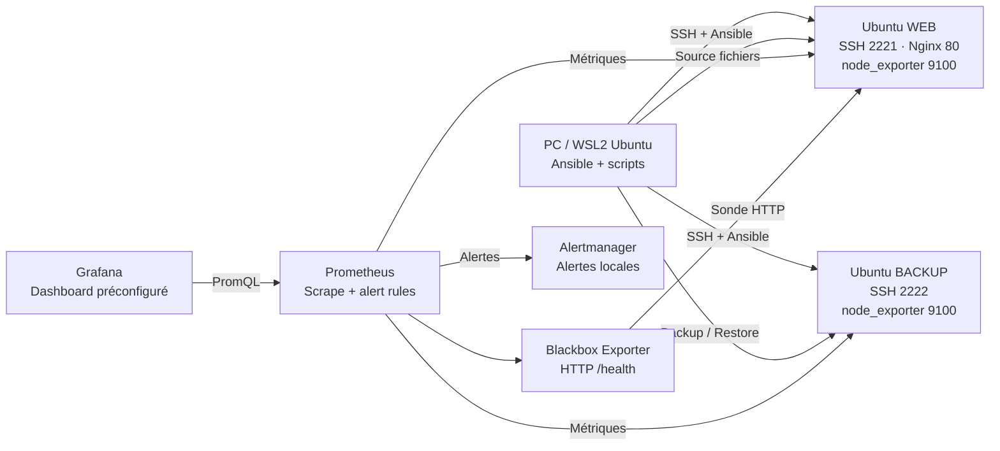

# Infrastructure Linux automatisée et supervisée

**Projet personnel — Administration Linux, Ansible, SSH, Prometheus, Grafana et sauvegardes**

Mini-laboratoire pour apprendre à **administrer plusieurs hôtes Ubuntu**, déployer un service avec **Ansible via SSH**, observer son fonctionnement dans **Grafana**, diagnostiquer une panne et **restaurer une sauvegarde vérifiée**.

> **Validation vérifiée le 15 novembre 2026 :** les **21 tests statiques**, le déploiement Docker/Ansible par SSH, l'idempotence, la supervision Prometheus/Grafana, la sauvegarde/restauration SHA-256 et le scénario d'incident Nginx (alerte déclenchée puis résolue) sont passés sur le runner **Ubuntu 24.04 GitHub Actions**. [Consulter l'exécution réussie](https://github.com/K4ROUI/linux-infrastructure-automation-monitoring/actions/runs/43718378358). Ces résultats prouvent un essai en CI, **pas** une installation physique ou une expérimentation déjà réalisée sur mon PC. **Ne pas présenter** ces validations comme des tests sur serveurs physiques ou comme une expérience professionnelle.
>
> **Type d'environnement :** les « serveurs Ubuntu » sont des **conteneurs Docker**, **pas des machines virtuelles ni des serveurs physiques**. Ce choix permet de reproduire le lab sans trois VM. Ansible se connecte réellement en **SSH** aux deux hôtes conteneurisés.

## Architecture



**Rôles et fonctionnement :**

| Élément | Technologie | Objectif |
| --- | --- | --- |
| Contrôleur | Bash + Ansible + OpenSSH | Déployer et vérifier les configurations |
| Hôte `web` | Ubuntu 24.04, Nginx, node_exporter | Serveur HTTP et métriques système |
| Hôte `backup` | Ubuntu 24.04, node_exporter | Stocker des snapshots du site web |
| Monitoring | Prometheus, Blackbox Exporter | Métriques et test de disponibilité HTTP |
| Tableau de bord | Grafana | État des services et métriques |
| Alertes | Alertmanager | Voir les alertes localement, sans email externe |

Les ports sont exposés **uniquement sur `127.0.0.1`** de la machine hôte. Les connexions SSH utilisent une **clé générée localement**, et l'authentification par mot de passe SSH est désactivée.

## Prérequis

- Linux (Ubuntu/Debian) **ou Windows avec WSL2 Ubuntu et Docker Desktop intégré à WSL2**.
- **Docker Engine / Docker Desktop** et le plugin `docker compose`.
- **Ansible**, **OpenSSH client**, **Bash**, **Python 3**, **curl** et `ssh-keygen`/`ssh-keyscan` sur le contrôleur.
- Environ 3 Go de RAM disponible, de l'espace disque pour les images et l'accès Internet pour les télécharger.
- Ports locaux libres : `2221`, `2222`, `8088`, `3000`, `9090`, `9093`.

Sur Ubuntu (installation de **Ansible**, Bash et utilitaires ; installer Docker séparément via sa documentation officielle) :

```bash
sudo apt-get update
sudo apt-get install -y ansible-core openssh-client curl python3
```

> **Attention :** le compte de démonstration `labadmin` est autorisé à faire `sudo` sans mot de passe **dans ces conteneurs isolés**. Ce choix facilite les TP et **ne doit pas être reproduit tel quel en production**. Docker ne remplace pas l'isolation d'une VM.

## Démarrage rapide

```bash
git clone https://github.com/K4ROUI/linux-infrastructure-automation-monitoring.git
cd linux-infrastructure-automation-monitoring

# 1. Générer une clé SSH dédiée et un secret Grafana (non versionnés)
bash scripts/lab.sh init

# 2. Démarrer les hôtes Ubuntu et l'infrastructure de supervision
bash scripts/lab.sh up

# 3. Configurer les hôtes Ubuntu via Ansible + SSH
bash scripts/lab.sh provision

# 4. Vérifier SSH, HTTP, deux exporters, Grafana et Prometheus
bash scripts/lab.sh test

# 5. Afficher le statut des conteneurs
bash scripts/lab.sh status
```

**Le playbook Ansible peut être relancé** : après la première exécution, les ressources déjà conformes ne doivent plus être modifiées. Le lab se configure sans copier de clés privées ni mots de passe dans le dépôt Git.

## Interfaces locales

| Service | URL | Connexion |
| --- | --- | --- |
| Site Nginx | http://127.0.0.1:8088 | Publique **sur localhost seulement** |
| Santé HTTP | http://127.0.0.1:8088/health | Renvoie `ok` |
| Grafana | http://127.0.0.1:3000 | `admin` et mot de passe dans `.env` |
| Prometheus | http://127.0.0.1:9090 | Interface PromQL locale |
| Alertmanager | http://127.0.0.1:9093 | Alertes locales, **sans notification externe** |

Les interfaces de supervision n'ont **pas de TLS** : elles sont réservées à un hôte de test local. Ne pas publier ces ports sur le réseau ou sur Internet.

## Expérience 1 — Vérifier la supervision

Dans Grafana, ouvrir le dossier **Linux et réseaux**, puis le tableau de bord **Linux Infrastructure | Lab**. Le fichier JSON du dashboard et la datasource Prometheus sont provisionnés automatiquement.

Les requêtes principales sont :

```promql
up{job="node-linux"}
probe_success{job="http-health"}
node_memory_MemAvailable_bytes{job="node-linux"}
```

**Interprétation :** `up` vérifie que Prometheus arrive à interroger l'exporter, tandis que `probe_success` vérifie qu'un **service HTTP répond**. Un exporter actif ne prouve pas que Nginx fonctionne. Les métriques CPU/RAM exposées par `node_exporter` **dans les conteneurs** peuvent refléter le noyau de l'hôte et ne sont **pas** des mesures isolées équivalentes à celles de VM.

## Expérience 2 — Provoquer une panne et observer une alerte

```bash
bash scripts/lab.sh incident
# Attendre le délai de scrutation et les 20 s de la règle d'alerte.
python3 scripts/check_alert.py --state firing

# La règle WebServiceUnavailable doit apparaître dans Prometheus/Alertmanager.
bash scripts/lab.sh recover
python3 scripts/check_alert.py --state resolved
bash scripts/lab.sh test
```

La commande `incident` arrête Nginx **dans le conteneur web uniquement**. La sonde Blackbox doit finir par renvoyer 0, puis Prometheus activer l'alerte `WebServiceUnavailable`. La commande `recover` rétablit Nginx. Il n'y a **aucun email ou SMS envoyé** automatiquement.

## Expérience 3 — Sauvegarde, vérification et restauration

```bash
bash scripts/lab.sh backup
# Retenir l'identifiant affiché, par exemple snapshot-20261115T120000Z-1234.
bash scripts/lab.sh restore <ID_SNAPSHOT>

# Refaire les tests de santé
bash scripts/lab.sh test
```

La sauvegarde copie le **contenu du répertoire du site** depuis le conteneur `web` vers le conteneur `backup`, dans un **volume Docker persistant**. Les empreintes SHA-256 de `index.html` sont comparées après la copie et après restauration. **Ne couvre pas** la sauvegarde de toute l'OS, de la configuration Nginx, des bases de données ou d'un site distant. Les deux conteneurs et les volumes résident sur le **même hôte Docker** : ce n'est pas une stratégie de reprise après sinistre complète.

Les sauvegardes sont **déclenchées manuellement**. Un exemple de programmation **optionnelle** par cron du contrôleur figure dans [docs/operations.md](docs/operations.md).

## Vérification sans Docker (statique)

```bash
python3 -m venv .venv
.venv/bin/pip install -r requirements-dev.txt
.venv/bin/python -m unittest discover -s tests -v
for f in scripts/*.sh docker/ubuntu-host/entrypoint.sh; do bash -n "$f"; done
```

Ces commandes vérifient la cohérence des fichiers ; **elles ne prouvent pas le fonctionnement réseau**. Les tests réels sont prévus dans [GitHub Actions](.github/workflows/ci.yml) lorsque le projet est publié.

## Structure du dépôt

```text
linux-infrastructure-automation-monitoring/
├── README.md
├── compose.yaml
├── .env.example
├── requirements-dev.txt
├── .gitignore
├── .github/workflows/ci.yml
├── docker/ubuntu-host/{Dockerfile,entrypoint.sh,ssh-hardening.conf,supervisor-lab.conf}
├── ansible/{inventory.ini,site.yml,templates/}
├── monitoring/
│   ├── prometheus/{prometheus.yml,alerts.yml}
│   ├── alertmanager/alertmanager.yml
│   ├── blackbox/blackbox.yml
│   └── grafana/{provisioning/,dashboards/}
├── scripts/{lab.sh,backup.sh,restore.sh,check_metrics.py,check_alert.py}
├── tests/test_project.py
└── docs/{architecture.md,operations.md,validation.md}
```

## Documentation

- [Documentation officielle Ansible](https://docs.ansible.com/ansible/latest/index.html)
- [Documentation officielle Docker Compose](https://docs.docker.com/compose/)
- [Documentation officielle Prometheus](https://prometheus.io/docs/introduction/overview/)
- [Documentation officielle Grafana](https://grafana.com/docs/grafana/latest/)

- [Architecture, flux et limites de sécurité](docs/architecture.md)
- [Exploitation, diagnostic, sauvegardes et restauration](docs/operations.md)
- [Protocole de tests, éléments à prouver et résultats](docs/validation.md)

## Ce que ce projet permet de démontrer

Après une exécution complète : administration Linux à distance via SSH, mise en œuvre et relance idempotente d'un playbook Ansible, déploiement et diagnostic Nginx, métriques Prometheus, dashboards Grafana, détection d'incidents par sonde HTTP et sauvegardes vérifiées. Les résultats doivent être étayés par **les journaux réels des tests**, captures prises localement et exécutions GitHub Actions.
